# Overlap report: Rapier port

**Summary.** The final defaults (14 November) are continuous drag, growth spread over 5 groups
per cycle, anchors that let go at 2 units of stretch, and 8 solver iterations. With them, the
deepest cell–cell penetration stayed below **8%** of the cell width at every snapshot of the
3-seed × 120 000-step validation (worst 7.3%; 2 of 1173 snapshots above the original 5% target).
A typical full-chamber snapshot (~1740 cells) has its deepest pair at ~0.9% of the width and a
mean of 0.07%. You relaxed the target from 5% to about 8% in exchange for speed: 8 iterations
instead of 12 make a step ~19% faster than before these changes (NOTES.md, "Performance"). With 12
iterations the same model stays below 5% everywhere (worst 4.9%). With fewer than 8 iterations
single pairs exceed 8% (worst 10–21% at 5–6 iterations).
In the 600 000-step run with the final defaults, 1 of 1991 snapshots went over 8% (9.1%, a single
pair at the chamber exit) and 8 over 5%.

Earlier configurations are kept below for comparison. Anchors that never let go (the testbed's
behaviour) gave single pairs up to 20.8% deep, caused by stretched anchor springs. Box2D, measured
the same way, is over even the 8% target in most snapshots.

## What is measured

At every snapshot (every 300 steps) the runner measures, on the live simulation at full precision:

- **cell–cell penetration depth** for every pair of touching cells. Each cell is a capsule: the
  segment between its end-cap centres, swept by the radius. Two cells overlap by
  `2·radius − distance(axis₁, axis₂)` when that is positive. Pairs are found with a uniform grid
  (cell size = longest cell + 2·radius), so every touching pair is tested exactly once.
- per snapshot: the **max**, the **mean over overlapping pairs**, the **99th percentile**, the
  number of overlapping pairs and of pairs deeper than the target, and where the deepest pair is;
- **cell–wall penetration**: the deepest any cell axis comes within one radius of the side and top
  walls or of the small wall triangles (a cell axis crossing a wall counts as one radius).

The exported states cannot be used for this: they are rounded to 2 decimals and `an` to 0.01·π,
which alone moves a cell tip by up to ~0.03 (4% of the width).

**Target:** max cell–cell penetration < 8% of the cell width (0.064 for width 0.8) at every
snapshot after a **warm-up of 3000 steps**. The target was 5% (0.040) until 14 November;
the tables below show both. The initial 1000 cells are placed at random and
overlap heavily (pairs crossing each other completely); Rapier separates them in ~1500–3000 steps.
Resting contacts always sit slightly inside each other (~0.1–0.5% of the width): Rapier's allowed
penetration and soft contacts.

Tools: `run.js --overlap-log FILE [--overlap-check]`, `tools/overlap_report.py` (tables),
`tools/overlap_chart.py` (charts), and in the browser the overlap readout and the diagnostic view.

## Final defaults on three seeds (120 000 steps each)

Rapier with the final defaults: continuous drag (`continuousDrag=1`), growth in 5 groups per
25-step cycle (`growthGroups=5`), anchors that let go at 2 units (`anchorMaxStretch=2`), **8 solver
iterations**, 720 Hz contact stiffness, colliders replaced on growth with the world rebuilt every
10 000 steps. Seeds 7, 11 and 23. Statistics over the 391 snapshots after the warm-up (step
3000–120 000) of each run; percentages of the cell width.

| Seed | Over 8% | Over 5% | Worst max | Median max | Mean (overlapping pairs) | Worst 99th pct | Wall: median / worst |
|---|---|---|---|---|---|---|---|
| 7 | **0** / 391 | 0 | 3.6% | 0.89% | 0.07% | 0.69% | 3.5% / 16% |
| 11 | **0** / 391 | 0 | 3.9% | 0.90% | 0.06% | 0.73% | 3.8% / 13% |
| 23 | **0** / 391 | 2 | 7.3% | 0.94% | 0.08% | 0.90% | 3.7% / 16% |

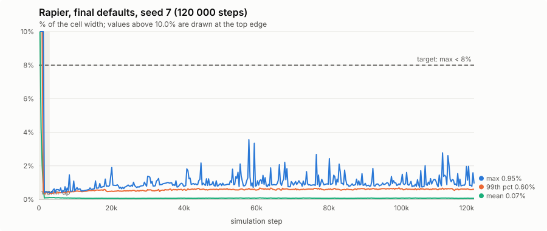
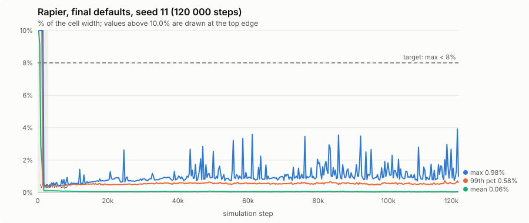
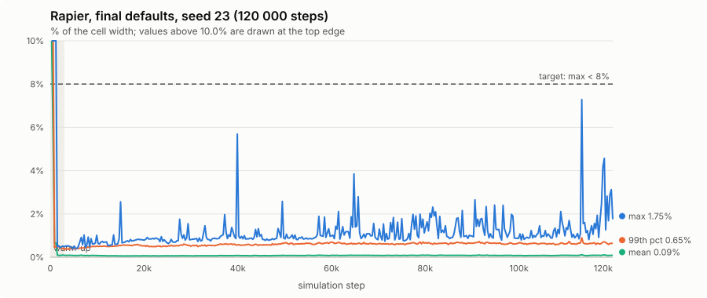

Logs: `data/overlap-rapier-final-seed*-120k.csv`.

## Long run: 600 000 steps (seed 7, final defaults)

`node bacteria/build/run.js --steps 600000 --seed 7 --overlap-log …` took 1 h 38 min (the overnight
run took 2 h 32 min). It exported 2000 snapshots (`bacteria/output/states-rapier-600k-seed7.json`,
189 MB, 105 780 cell ids; not in git). Log: `data/overlap-rapier-final-seed7-600k.csv`.

| | |
|---|---|
| Snapshots after the warm-up | 1991 |
| Over 8% / over 5% | **1** / 8 |
| Worst max | 9.1% (step 572 100, one pair at x −43.3, y 140.6: at the exit, near the left wall) |
| Max per snapshot: median / 99th percentile | 0.98% / 3.6% |
| Mean over overlapping pairs (average) | 0.08% |
| Worst 99th percentile of pair depths in a snapshot | 0.81% |
| Cells once full (step > 30 000) | 1706–1810, mean 1757 |
| Cell–wall: median / 90th percentile / worst | 4.6% / 8.9% / 28% |

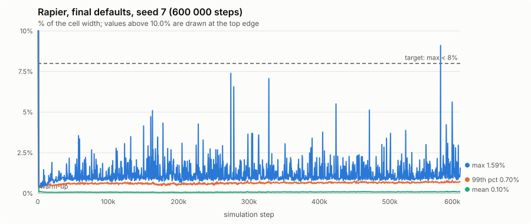

The 8 snapshots over 5% are spread over the run (steps 162 900–588 600), each with a single
pair. The statistics stay flat, with no drift. The 120 000-step validation of seed 7 had no
snapshot over 5%: this run's first 120 000 steps are identical to it, and the exceptions all come
later. So over long runs the 8% target holds in 99.95% of snapshots, not in all. With 12 solver
iterations (~1.5× the step time) there was no snapshot over 5% in 1173.

Organisation, averages per 120 000-step window (`tools/organization.py`): centre ⟨cos 2θ⟩ +0.49,
then +0.52 to +0.54; wall zones −0.14, then −0.03 to −0.05; 1733–1763 cells; mean length
2.90–2.91.

## Continuous drag, growth groups and solver iterations

Same three seeds × 120 000 steps (2- and 3-iteration runs: seed 7, 60 000 steps), all with
continuous drag and anchors that let go at 2 units. Columns: snapshots over 8% / over 5% (of 391
per seed, summed over seeds), worst max, median max, mean.

| Growth groups, solver iterations | Over 8% | Over 5% | Worst max | Median max | Mean |
|---|---|---|---|---|---|
| 25 groups, 12 iterations | 0 | 0 | 4.2% | 0.64–0.78% | 0.03% |
| 5 groups, 12 iterations | 0 | 0 | 4.9% | 0.84–0.87% | 0.06% |
| **5 groups, 8 iterations (default)** | **0** | 2 | 7.3% | 0.89–0.94% | 0.07% |
| 5 groups, 6 iterations | 4 | 17 | 20.6% | 1.2–1.3% | 0.09% |
| 5 groups, 5 iterations | 8 | 34 | 18.6% | 1.6–1.8% | 0.11% |
| 5 groups, 4 iterations (to ~57 000 steps) | 10 | 26 | 25.7% | 1.7–2.0% | 0.11% |
| 5 groups, 3 iterations (seed 7) | 20 of 191 | 58 of 191 | 16.8% | 3.8% | 0.18% |
| 5 groups, 2 iterations (seed 7) | 130 of 191 | 142 of 191 | 56.9% | 13.8% | 0.33% |
| for comparison: the testbed's drag kick and synchronous growth, 12 iterations | 0 | 0 | 3.4% | 0.96–0.97% | 0.17% |

Continuous drag with spread growth roughly halves the typical overlap, because cells are no longer
stopped and pushed again all at once. Fewer solver iterations trade this margin for speed. 8 is
the fewest that stays below 8% on all three seeds. Logs: `data/overlap-rapier-smooth-g*-it*-*.csv`.

## Anchors that never let go (the testbed's behaviour; the default until 14 November)

These runs used the testbed's drag kick, synchronous growth and 12 iterations; "over the
target" here means over 5%. With `anchorMaxStretch=0` the same three seeds had a few exceptions,
and the 600 000-step run had 20:

| Run | Snapshots over the target | Worst max | Median max | Mean | Wall: median |
|---|---|---|---|---|---|
| seeds 7 / 11 / 23, 120 000 steps | 2 / 2 / 2 of 391 | 20.8% / 6.8% / 10.2% | 1.0% | 0.19% | 12–15% |
| seed 7, 600 000 steps | 20 of 1991 (1.0%) | 20.8% | 1.0% | 0.19% | 15% |
| for comparison: `anchorMaxStretch=1`, seeds 7 / 11 / 23 | 0 / 0 / 0 of 391 | 3.4% | 1.0% | 0.17% | 2% |

Each exception was one pair (two pairs in a few snapshots), for a single snapshot. In the long run
15 of the 20 were under 10%; all were in the upper part of the chamber (y 149–198), mostly near
the side walls, where anchored cells sit.

**Cause (traced at seed 7, step 65 700, 20.8%):** two cells in the wall zone, each held by two
anchor springs stretched by 3–8 units. Anchors are 0.8 Hz springs (as in the testbed), too soft
to hold a cell, so once the chamber is full the colony drags anchored cells several units away;
the stretched spring then pulls back with ~ω²·stretch ≈ 160 units/s² (stretch 6), far above
anything else acting on a cell. The two cells jitter against their neighbours at ~1 unit/s; one
spins up from 0.04 to 5 rad/s within 9 steps and lands 0.17 inside the other, and the solver
pushes it out over the next steps.

Letting anchors go also changes how the colony organises (averages over steps 15 000–120 000;
⟨cos 2θ⟩ = +1 for cells pointing at the exit, −1 for cells lying across the chamber):

| Anchors | ⟨cos 2θ⟩ centre (seeds 7 / 11 / 23) | ⟨cos 2θ⟩ wall zones | cells |
|---|---|---|---|
| never let go | +0.30 / +0.29 / +0.30 | −0.19 / −0.18 / −0.23 | 1725–1734 |
| **let go at 2 units (default)** | +0.52 / +0.49 / +0.47 | −0.13 / −0.19 / −0.19 | 1735–1746 |
| let go at 1 unit | +0.56 / +0.60 / +0.62 | −0.01 / +0.07 / +0.15 | 1752–1758 |

At 2 units the centre aligns more strongly with the flow, and the wall zones keep their
organisation, with cells lying across the chamber. At 1 unit the wall zones change too.

Logs: `data/overlap-rapier-anchorhold-*.csv` (anchors never let go), `data/overlap-rapier-anchorstretch{1,2}-*.csv`.

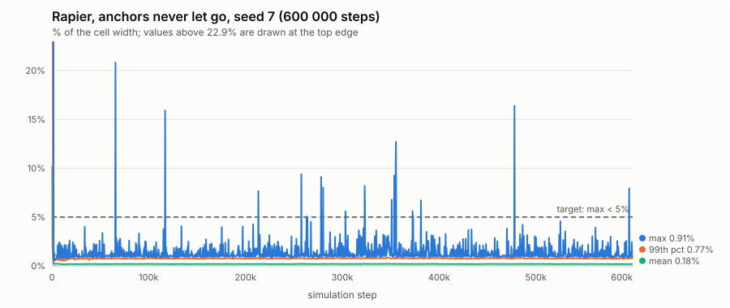

## Other settings and Box2D (same measurement)

All Rapier rows here ran with anchors that never let go, the testbed's drag kick and synchronous
growth; compare them with the first row. "Over the target" means over 5%. Box2D is over 8% in
most snapshots too (median max 31–39%).

| Run | Snapshots over the target | Worst max | Median max | Mean | Worst 99th pct |
|---|---|---|---|---|---|
| Rapier, final solver settings, anchors never let go, seeds 7 / 11 / 23 | 2 / 2 / 2 of 391 | 20.8% | 1.0% | 0.19% | 0.8% |
| same, but **no world rebuild** (leaks memory) | 0 / 0 / 0 of 391 | 4.9% | 1.0% | 0.19% | 0.8% |
| same, but contacts refreshed by turning colliders by π | 2 / 2 / 8 of 391 | 11.2% | 1.0% | 0.19% | 0.9% |
| Rapier, 12 it., 480 Hz (no rebuild) | 2 / 0 / 1 of 391 | 8.7% / 4.3% / 100%¹ | 1.0% | 0.20% | 0.9% |
| Rapier, 8 it., 480 Hz (no rebuild) | 6 / 3 / 9 of 391 | 13.6% | 1.3–1.5% | 0.21% | 1.3% |
| Rapier, Rapier's own solver defaults (4 it., 30 Hz), before the other fixes, seed 7, 30 000 steps | 62 / 91 | 100% | 15.6% | 1.7% | 27% |
| **Box2D**, anchors never let go, seed 7, 30 000 steps | **86 / 91** | 100% | 38.8% | 6.8% | 100% |
| **Box2D**, final defaults (anchors let go at 2 units), seed 7, 30 000 steps | **87 / 91** | 100% | 31.0% | 6.7% | 100% |

¹ a pair that crossed at the random start and separated only after the warm-up.

Without world rebuilds there were no exceptions (0 of 1173 vs 6 of 1173 with rebuilds). The runs
follow different trajectories after the first rebuild (step 10 000) and the events are rare, but
0 vs 6 is unlikely to be pure chance (p ≈ 0.03), so the rebuild may contribute, e.g. through the
contact and spring caches starting cold (positions, angles, velocities, masses and springs are
carried over exactly). It does not cause exceptions on its own: the `anchorMaxStretch` runs also
rebuild every 10 000 steps and had none in 2346 snapshots. Running without rebuilds is not an
option for long runs (memory; see NOTES.md).

The Box2D port is far from the target: its random start leaves pairs crossed through each other
for the whole run (it never separates them), and once the chamber fills its packing is denser
(~1850–1940 cells vs ~1700–1760 in Rapier) with ~340 pairs per snapshot deeper than the target.

## Cell–wall penetration

Not part of the target (pairwise), but measured. With the final defaults the deepest cell–wall
contact per snapshot is typically 3.5–3.8% of the cell width (median per seed), and at worst
13–16%. These deepest contacts are in the dead-end top corners and between the small wall
triangles, where the colony's pressure ends. Before continuous drag and spread growth, with anchors
letting go, the median was 4–5% and a cell's axis occasionally reached a wall line (46–50%). With
anchors that never let go the median was 12–15%.

## Browser screenshots

A 60 000-step session in headless Chrome with the final defaults (`index.html?seed=7`, 200 steps
per frame; the page confirmed `anchorMaxStretch=2`, `growthGroups=5`, `continuousDrag=1`, 8
iterations), paused every ~6000 steps for screenshots. Each pause took the whole chamber in the
phase-contrast and diagnostic views, plus diagnostic close-ups (~18 × 11 units) around the
deepest pair at the last snapshot and of the top-left corner. In the diagnostic view each cell has
its true capsule outline, and anchors are black squares with a line to their cell. Pairs deeper
than 1% of the width are drawn orange, deeper than the target (8%) red. At the close-up zoom one
pixel is ~0.013 units, so a 5% overlap (0.04) would show as ~3 pixels of outline crossing a
neighbour. The phase-contrast and fluorescence views have since been replaced by the simple view
(16 November). Their screenshots were removed, and the last row shows the simple view from a
separate session (seed 7, step 12 200).

Readouts at each pause (overlap at the last snapshot; `screenshots/browser-session.log`): max
0.41–1.38% at every pause from step 6400 to 60 200; mean 0.06–0.09%; deepest wall contact
0.3–5%. There were no red pairs and no page errors, and the images show no visible overlap. The
session also downloaded the states through the page's own `download()`: 17.6 MB, 205 snapshots,
10 834 cell ids, valid `LowRes.json`. In the page, physics took 10.5 ms per step at ~1710 cells,
measured with other runs sharing the CPU.

| | |
|---|---|
| 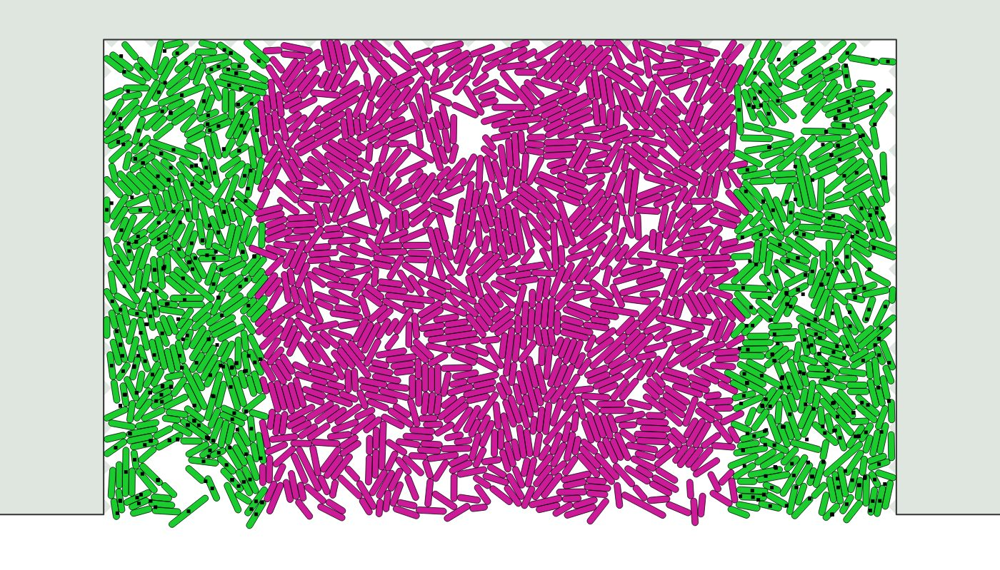 | 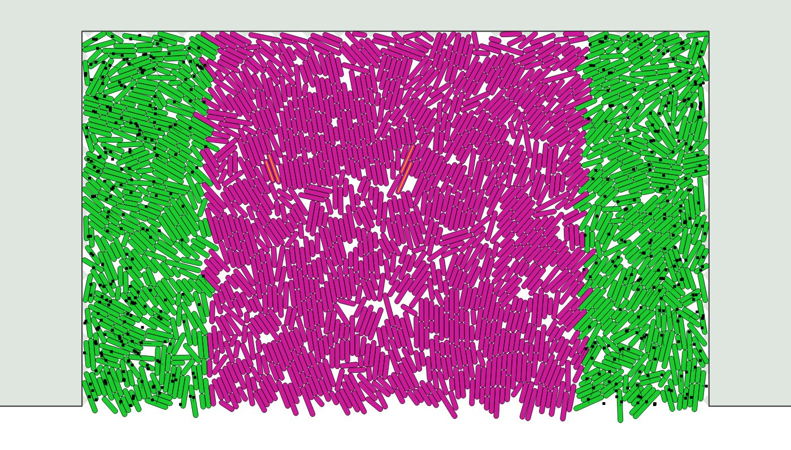 |
| 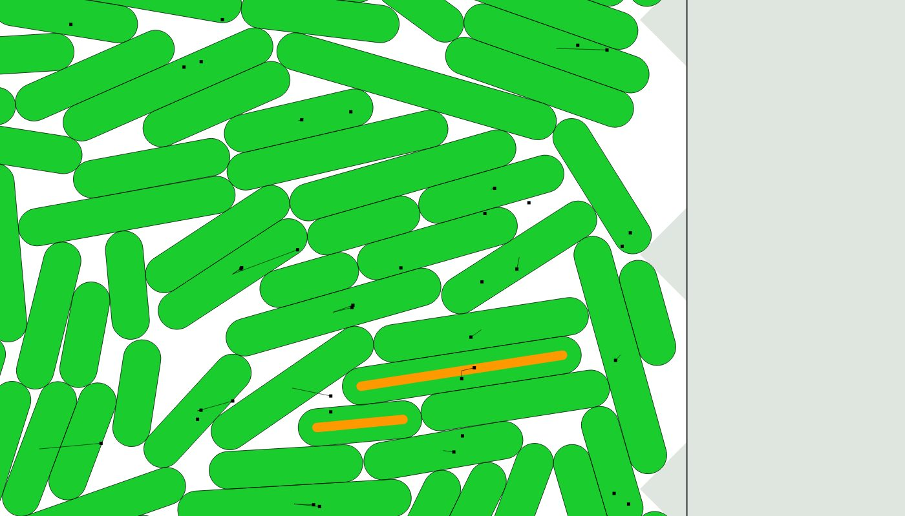 | 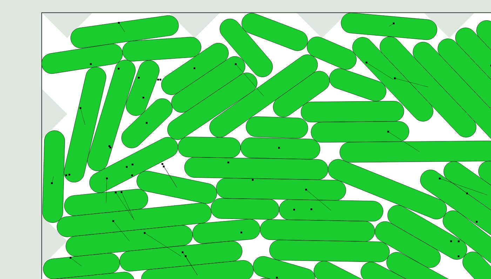 |
| 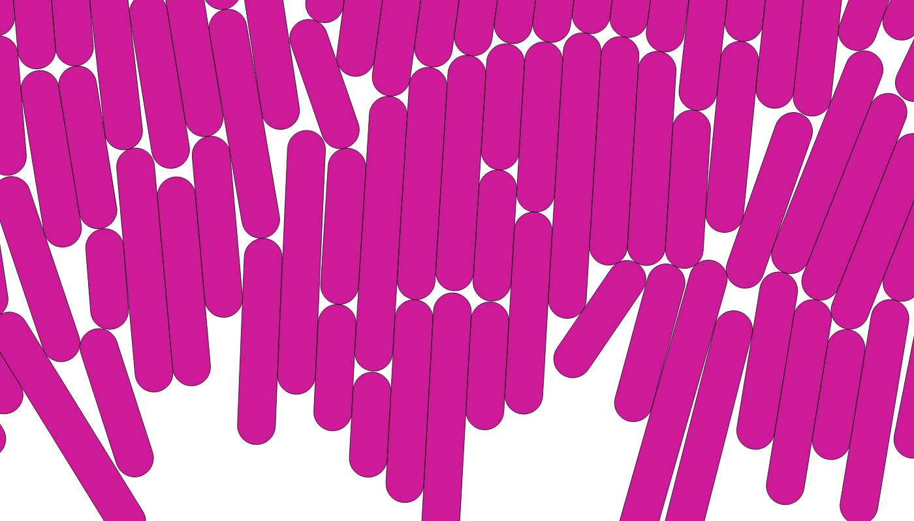 | 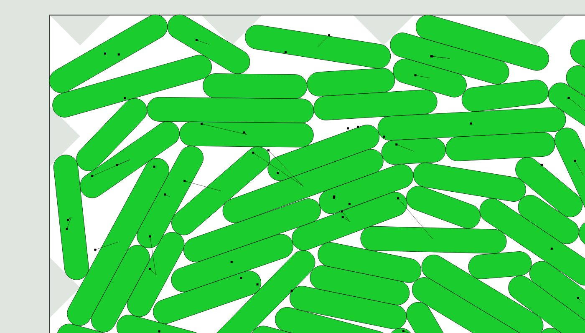 |
| 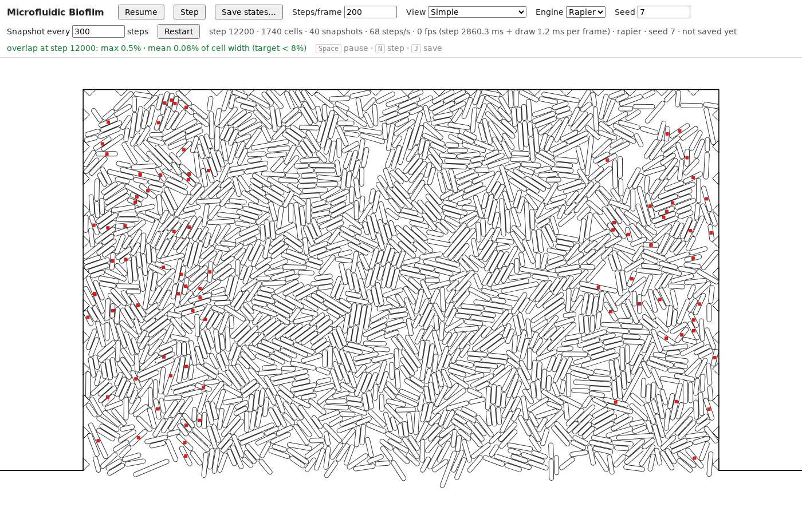 | 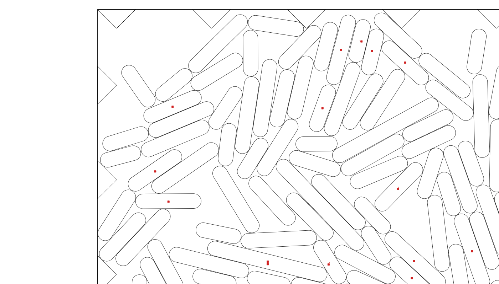 |
