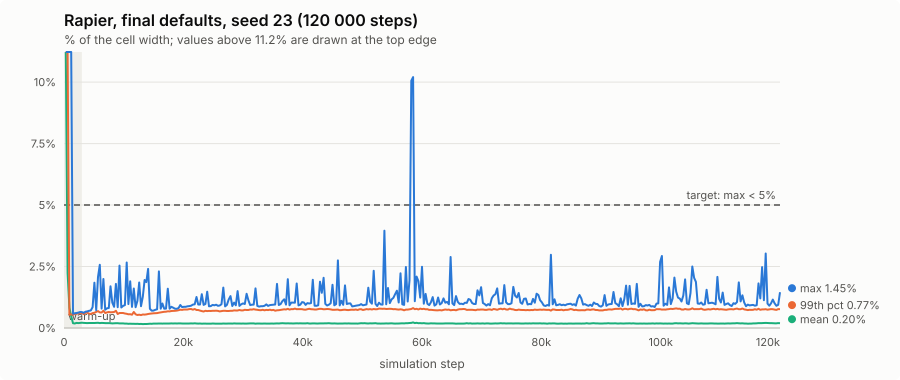

# Overlap report: Rapier port

<!-- SUMMARY -->

## What is measured

At every snapshot (every 300 steps) the runner measures, on the live simulation at full precision:

- **cell–cell penetration depth** for every pair of touching cells. Each cell is a capsule: the
  segment between its end-cap centres, swept by the radius. Two cells overlap by
  `2·radius − distance(axis₁, axis₂)` when that is positive. Pairs are found with a uniform grid
  (cell size = longest cell + 2·radius), so every touching pair is tested exactly once.
- per snapshot: the **max**, the **mean over overlapping pairs**, the **99th percentile**, the
  number of overlapping pairs and of pairs deeper than the target, and where the deepest pair is;
- **cell–wall penetration**: the deepest any cell axis comes within one radius of the side and top
  walls or of the small wall triangles (a cell axis crossing a wall counts as one radius).

The exported states cannot be used for this: they are rounded to 2 decimals and `an` to 0.01·π,
which alone moves a cell tip by up to ~0.03 (4% of the width).

**Target:** max cell–cell penetration < 5% of the cell width (0.040 for width 0.8) at every
snapshot after a **warm-up of 3000 steps**. The initial 1000 cells are placed at random and
overlap heavily (pairs crossing each other completely); Rapier separates them in ~1500–3000 steps.
Resting contacts always sit slightly inside each other (~0.1–0.5% of the width): Rapier's allowed
penetration and soft contacts.

Tools: `run.js --overlap-log FILE [--overlap-check]`, `tools/overlap_report.py` (tables),
`tools/overlap_chart.py` (charts), and in the browser the overlap readout and the diagnostic view.

## Final defaults on three seeds (120 000 steps each)

Rapier with the final defaults (12 solver iterations, 720 Hz contact stiffness, colliders
replaced on growth with the world rebuilt every 10 000 steps, all model fixes), seeds 7, 11 and
23. Statistics over the 391 snapshots after the warm-up (step 3000–120 000) of each run;
percentages of the cell width.

| Seed | Snapshots over the target | Worst max | Median max | Mean (overlapping pairs) | Worst 99th pct | Wall: median / worst |
|---|---|---|---|---|---|---|
| 7 | 2 / 391 | 20.8% | 0.99% | 0.19% | 0.81% | 12% / 50% |
| 11 | 2 / 391 | 6.8% | 0.97% | 0.19% | 0.83% | 15% / 50% |
| 23 | 2 / 391 | 10.2% | 0.98% | 0.19% | 0.81% | 12% / 50% |

Typical state once the chamber is full (~1700–1760 cells, ~2700 touching pairs): mean penetration
0.2% of the width, 99% of contacts below 0.8%, the deepest pair around 1%. The target is met in
**99.5%** of snapshots; each exception is a single pair for one or two snapshots.

## Where the exceptions come from

Traced one (seed 7, step 65 700, 20.8%): two cells in the wall zone, each held by two anchor
springs stretched by 3–8 units. Anchors are 0.8 Hz springs (as in the testbed), too soft to hold a
cell, so once the chamber is full the colony drags anchored cells several units away; the
stretched spring then pulls back with ~ω²·stretch ≈ 160 units/s² (stretch 6), far above anything
else acting on a cell. The two cells jitter against their neighbours at ~1 unit/s; one spins up
from 0.04 to 5 rad/s within 9 steps and lands 0.17 inside the other, and the solver pushes it out
over the next steps.

**Check:** with `anchorMaxStretch` (an anchor lets go when its cell is farther than this from the
anchor point; off by default) the exceptions disappear:

| Run (3 seeds × 120 000 steps) | Snapshots over the target | Worst max | Wall: median |
|---|---|---|---|
| defaults | 2 / 2 / 2 of 391 | 20.8% | 12–15% |
| `anchorMaxStretch=2` | **0 / 0 / 0** of 391 | 3.4% | 4–5% |
| `anchorMaxStretch=1` | **0 / 0 / 0** of 391 | 3.4% | 2% |

It also changes the colony's organisation (centre alignment ⟨cos 2θ⟩ +0.30 → +0.52 / +0.56), so it
is a modelling decision, not a solver setting, and the default keeps the testbed's anchors. See
NOTES.md ("Worth reviewing").

## Other settings and Box2D (same measurement)

| Run | Snapshots over the target | Worst max | Median max | Mean | Worst 99th pct |
|---|---|---|---|---|---|
| Rapier, defaults but **no world rebuild** (leaks memory), seeds 7 / 11 / 23 | 0 / 0 / 0 of 391 | 4.9% | 1.0% | 0.19% | 0.8% |
| Rapier, defaults but contacts refreshed by turning colliders by π | 2 / 2 / 8 of 391 | 11.2% | 1.0% | 0.19% | 0.9% |
| Rapier, 12 it., 480 Hz (no rebuild) | 2 / 0 / 1 of 391 | 8.7% / 4.3% / 100%¹ | 1.0% | 0.20% | 0.9% |
| Rapier, 8 it., 480 Hz (no rebuild) | 6 / 3 / 9 of 391 | 13.6% | 1.3–1.5% | 0.21% | 1.3% |
| Rapier, Rapier's own solver defaults (4 it., 30 Hz), before the other fixes, seed 7, 30 000 steps | 62 / 91 | 100% | 15.6% | 1.7% | 27% |
| **Box2D** (current model settings), seed 7, 30 000 steps | **86 / 91** | 100% | 38.8% | 6.8% | 100% |

¹ a pair that crossed at the random start and separated only after the warm-up.

Without world rebuilds there were no exceptions (0 of 1173 vs 6 of 1173 with rebuilds). The runs
follow different trajectories after the first rebuild (step 10 000) and the events are rare, but
0 vs 6 is unlikely to be pure chance (p ≈ 0.03), so the rebuild may contribute, e.g. through the
contact and spring caches starting cold (positions, angles, velocities, masses and springs are
carried over exactly). It does not cause exceptions on its own: the `anchorMaxStretch` runs also
rebuild every 10 000 steps and had none in 2346 snapshots. Running without rebuilds is not an
option for long runs (memory; see NOTES.md).

The Box2D port is far from the target: its random start leaves pairs crossed through each other
for the whole run (it never separates them), and once the chamber fills its packing is denser
(~1850–1940 cells vs ~1700–1760 in Rapier) with ~340 pairs per snapshot deeper than the target.

## Cell–wall penetration

Not part of the target (pairwise), but measured. With the defaults the deepest cell–wall contact
per snapshot is typically ~12–15% of the width, in the dead-end top corners and between the small
wall triangles, where anchored cells and the colony's pressure end; occasionally a cell's axis
reaches a wall line (50%). With `anchorMaxStretch` it drops to 2–5% (see above).

<!-- LONGRUN -->

<!-- SCREENSHOTS -->
